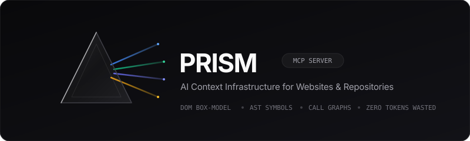

<p align="center">
  
</p>

# Prism

Deterministic web layout inspection and structural repository intelligence engine for AI coding agents via Model Context Protocol (MCP).

<p align="center">
  <a href="#supported-ai-agents--ecosystem"></a>
  <a href="#supported-ai-agents--ecosystem"></a>
  <a href="#supported-ai-agents--ecosystem"></a>
  <a href="#supported-ai-agents--ecosystem"></a>
  <a href="#supported-ai-agents--ecosystem"></a>
  <a href="#supported-ai-agents--ecosystem"></a>
  <a href="#supported-ai-agents--ecosystem"></a>
  <a href="#supported-ai-agents--ecosystem"></a>
</p>

## Quickstart (One-Line Universal Installer)

Install Prism, auto-configure MCP endpoints, and inject the native `SKILL.md` specification across 70+ supported AI agents in one command:

```bash
curl -fsSL https://raw.githubusercontent.com/whysooraj/prism/main/install.sh | bash
```

The installer:
1. Clones to `~/.prism` and builds the optimized binary.
2. Injects the `prism` MCP definition into all active client configs.
3. Injects the standardized `SKILL.md` into Universal (`~/.agents/skills/`), OpenClaw, Hermes Agent, Antigravity, Claude Code, Cursor, and 14+ other skill registries.
4. Verifies execution and reports status.

---

## The Problem

AI assistants fail at web design inspection and codebase analysis because they operate on low-signal approximations:
1. **Websites**: Assistants receive either uncomputed raw HTML (missing exact CSS computed values) or downscaled screenshots (where padding, alignment drift, WCAG contrast violations, and touch targets cannot be mathematically verified).
2. **Repositories**: Assistants either dump entire files into context (saturating tokens and inducing hallucinations) or rely on naive string grep (which lacks AST symbol understanding, caller/callee graphs, and route definitions).

Prism bridges this gap by providing deterministic, structured context:
- **Web**: Exact CSS box model (`padding`, `margin`, `rect`), computed typography & color tokens, WCAG contrast audit, 4/8pt spacing validation, and vector wireframe SVGs.
- **Code**: Ephemeral shallow repository acquisition, AST symbol parsing, caller/callee tracing, route mapping, and line-sliced retrieval.

---

## Supported AI Agents & Ecosystem

Prism adheres to both the **Model Context Protocol (MCP)** and the open **Agent Skills specification** (`agentskills.io` pioneered by Vercel Labs), supporting 70+ developer agents:

| Agent / Framework | Creator / Organization | Integration Type | Auto-Configured Path |
|---|---|---|---|
| **Antigravity (`agy`)** | Google DeepMind | Native MCP + Skill | `~/.gemini/config/mcp_config.json`<br>`~/.gemini/config/skills/prism/` |
| **OpenClaw** | OpenClaw Community | MCP + Skill | `~/.openclaw/mcp.json`<br>`~/.openclaw/skills/prism/` |
| **Hermes Agent** | Nous Research | MCP + Skill | `~/.hermes/mcp.json`<br>`~/.hermes/skills/prism/` |
| **Claude Code & Desktop** | Anthropic | MCP + Skill | `~/.claude.json`<br>`~/.claude/skills/prism/` |
| **Cursor** | Anysphere | MCP + Skill | `~/.config/Cursor/User/mcp.json`<br>`~/.cursor/skills/prism/` |
| **OpenCode** | OpenCode Project | Native MCP + Universal Skill | `~/.config/opencode/mcp.json` |
| **Pi Agent** | Inflection AI | MCP + Universal Skill | `~/.pi/mcp.json` |
| **Codex CLI** | OpenAI | MCP + Universal Skill | `~/.codex/mcp.json` |
| **Cline & Roo Code** | Roo / Cline Community | MCP + Universal Skill | `~/.config/Code/User/mcp.json`<br>`~/.roo/skills/prism/` |
| **Devin for Terminal** | Cognition AI | MCP + Skill | `~/.config/devin/skills/prism/` |
| **Goose** | Block | MCP + Skill | `~/.config/goose/skills/prism/` |
| **Windsurf** | Codeium | Native MCP | `~/.codeium/windsurf/mcp_config.json` |
| **OpenHands** | All-Hands AI | Universal Skill | `~/.openhands/skills/prism/` |
| **Continue** | Continue Dev | Universal Skill | `~/.continue/skills/prism/` |
| **Universal Agents** | Amp, Replit, Zed, Warp, Loaf, Kimi | Universal Skill | `~/.agents/skills/prism/` |

---

## Architecture

```
[ AI Assistant (agy / claude / cursor / opencode / pi / codex) ]
                               │
                 MCP (JSON-RPC via stdio / SSE)
                               │
                               ▼
                       [ PRISM ENGINE ]
            ┌──────────────────┴──────────────────┐
            ▼                                     ▼
      [ Web Pipeline ]                    [ Repo Pipeline ]
     • Playwright Chromium Engine        • Git Acquisition (--depth 1)
     • Box Model & Layout Tree           • AST Compiler (TS/JS/Py/Go/Rs)
     • Design Token Extractor            • Symbol Indexer & Call Graph
     • WCAG Contrast Auditor             • Route & Middleware Analyzer
     • Deterministic Wireframe SVG       • Surgical Line Slicer
     • SSRF Safety Boundary              • In-Memory Index Cache
```

---

## Tools Reference

| Tool | Parameters | Output | Description |
|---|---|---|---|
| `inspect_website` | `url`: string<br>`viewport?`: `{ width, height }`<br>`includeWireframeSvg?`: boolean<br>`includeA11y?`: boolean<br>`allowLocalhost?`: boolean | JSON (`WebInspectionResult`) | Extracts layout tree, box model, design tokens, WCAG contrast score, and wireframe SVG |
| `capture_screenshots` | `url`: string<br>`allowLocalhost?`: boolean | PNG Base64 (Desktop & Mobile) | Captures dual viewports (1440x900 and 390x844) |
| `index_repository` | `urlOrPath`: string<br>`branch?`: string<br>`authToken?`: string | JSON (`RepoIndexSummary`) | Fetches repo, extracts AST symbols, builds file tree and routes |
| `search_codebase` | `query`: string<br>`kind?`: `function\|class\|route...`<br>`limit?`: number | JSON (`CodeSymbol[]`) | Searches symbols and endpoints with AST relevance scoring |
| `get_file` | `filePath`: string<br>`startLine?`: number<br>`endLine?`: number | Formatted text with line numbers | Retrieves exact lines with line number prefix (`42 \| code`) |
| `trace_symbol` | `symbolName`: string | JSON (`SymbolTrace`) | Traces definitions, importers, and connected HTTP route handlers |
| `explain_architecture` | None | JSON (`ArchitectureSummary`) | Summarizes tech stack, key configs, entry points, and directory map |

---

## Manual Configuration

If you prefer manual setup rather than the one-line installer:

```bash
git clone https://github.com/whysooraj/prism.git ~/.prism
cd ~/.prism
npm install
npm run build
```

Then add to your client's MCP configuration:

```json
{
  "mcpServers": {
    "prism": {
      "command": "node",
      "args": ["/home/YOUR_USER/.prism/dist/index.js"]
    }
  }
}
```

---

## Verification & Testing

Prism comes with a native self-check suite verifying SSRF boundaries, Playwright DOM parsing, and AST symbol extraction:

```bash
npm test
```

---

## Security Model

- **SSRF Hardening**: By default, `inspect_website` intercepts and aborts requests to private IPv4/IPv6 subnets (`127.0.0.0/8`, `10.0.0.0/8`, `172.16.0.0/12`, `192.168.0.0/16`, `169.254.169.254`, `::1`) and local hostnames (`localhost`, `*.local`, `*.internal`).
- **Browser Sandboxing**: Runs headless Chromium with isolated incognito contexts that terminate immediately upon evaluation completion.
- **Controlled Ingestion**: Repositories are cloned shallowly with depth 1 into isolated user cache directories (`~/.cache/context-bridge/repos/`) and never shared across unauthorized boundaries.

---

## License

MIT
